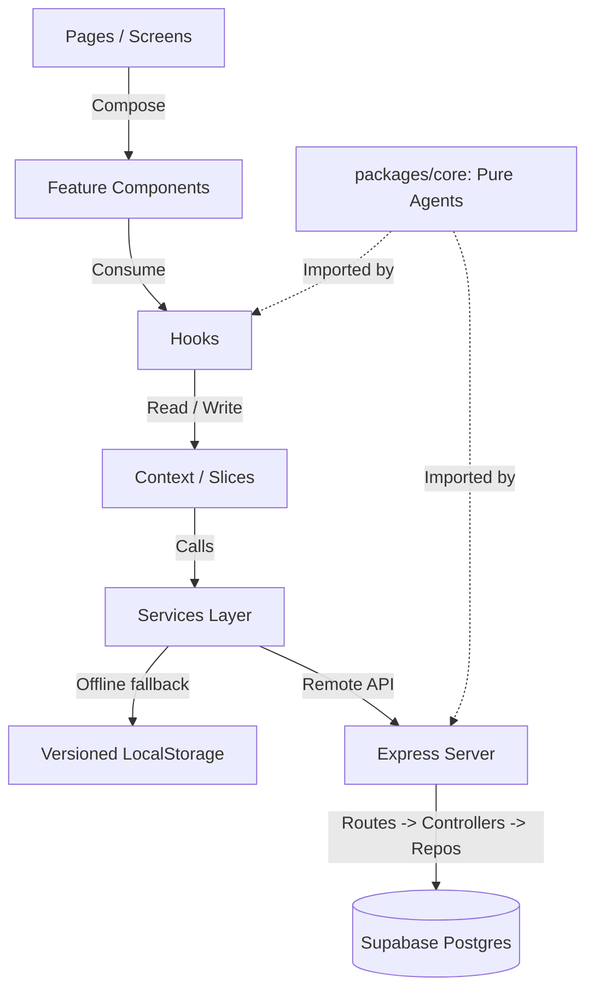

# BuildForce Architecture & Data Flow

## 1. System Overview & Unidirectional Data Flow

BuildForce AI is architected as an npm workspaces monorepo separating UI composition, client-side state, pure business logic, and API/persistence:

### Unidirectional Rules
1. **Pages** compose feature components and layout. Pages never execute calculations or call APIs directly.
2. **Feature Components** render UI elements using design tokens and atomic UI primitives (`Button`, `Card`, etc.). Max ~150 lines.
3. **Hooks** encapsulate state access and lifecycle. Max ~100 lines.
4. **Services** are the single gateway for data access. Components never call `fetch`, `axios`, `localStorage`, or `supabase` directly.
5. **Packages/Core** contains pure business logic (cash runway, 3-way match, CPM float scheduling, WhatsApp RFQ ranking). Zero React, DOM, or database imports.

---

## 2. Express Backend & Role Enforcement Security Rule

> ### ⚠️ CRITICAL BACKEND SECURITY REQUIREMENT
> When the Node/Express backend interacts with Supabase using `SUPABASE_SERVICE_KEY`, PostgreSQL **completely bypasses Row Level Security (RLS)** policies.
> 
> Therefore, every Express controller and service must:
> 1. **Explicitly enforce tenancy**: Verify `req.user.org_id === resource.org_id` before returning or mutating records.
> 2. **Enforce user roles**: Verify whether the user is an `owner`, `supervisor`, `accountant`, or `client`.
> 3. **Alternative**: Create scoped Supabase clients per request using the user's caller JWT (`supabase.auth.setSession(token)`) so Postgres RLS policies evaluate automatically.
